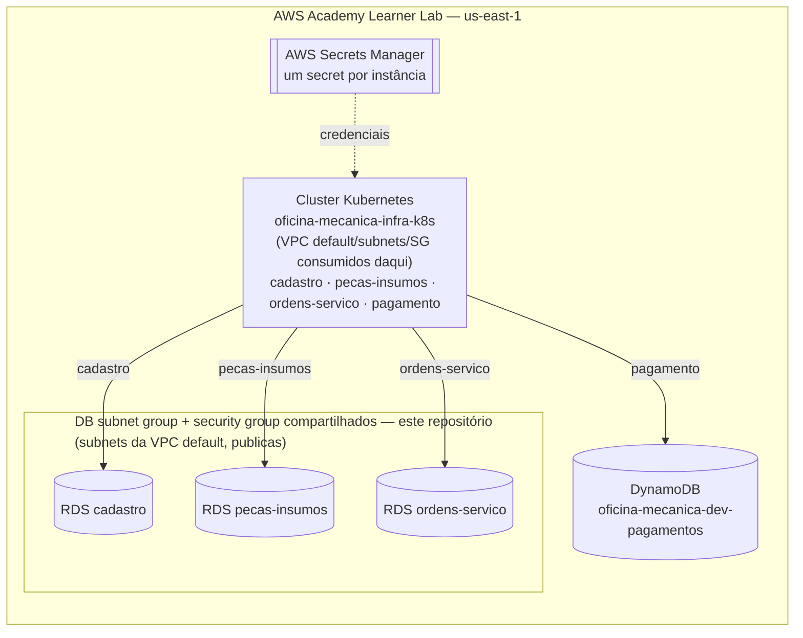

# oficina-mecanica-infra-db

Terraform dos bancos de dados gerenciados do **Sistema de Oficina Mecânica** — Tech Challenge da
pós-graduação em Arquitetura de Software (FIAP/SOAT), Fase 4 (microsserviços).

> **Estado atual: implementado, não aplicado.** O Terraform (uma instância RDS PostgreSQL por
> serviço + uma tabela DynamoDB) está escrito e passa em `fmt`/`validate`, mas ainda não rodou
> `plan`/`apply` — depende de duas coisas que só existem na sessão do Learner Lab: credenciais AWS e
> o state do repositório `oficina-mecanica-infra-k8s`, do qual este repositório consome a VPC. Ver
> [Decisões e pontos em aberto](#decisões-e-pontos-em-aberto).

---

## Índice

- [Propósito](#propósito)
- [Recursos provisionados](#recursos-provisionados)
- [Por que uma instância RDS por serviço](#por-que-uma-instância-rds-por-serviço)
- [Tecnologias utilizadas](#tecnologias-utilizadas)
- [Diagrama do componente](#diagrama-do-componente)
- [Contrato de outputs](#contrato-de-outputs)
- [Pré-requisitos](#pré-requisitos)
- [Instruções de execução](#instruções-de-execução)
- [Passos de deploy](#passos-de-deploy)
- [Explicação da pipeline](#explicação-da-pipeline)
- [Custo estimado e ordem de destruição](#custo-estimado-e-ordem-de-destruição)
- [Decisões e pontos em aberto](#decisões-e-pontos-em-aberto)

---

## Propósito

Provisionar, via Terraform, os **bancos de dados gerenciados** dos microsserviços:

- **Amazon RDS PostgreSQL 16, uma instância por serviço** com banco relacional (`cadastro`,
  `pecas-insumos`, `ordens-servico`), com subnet group privado e um security group compartilhado que
  libera a porta 5432 apenas ao cluster Kubernetes (`oficina-mecanica-infra-k8s`);
- **Amazon DynamoDB** (NoSQL) para os registros do serviço de **Pagamento**;
- as credenciais de cada instância publicadas no AWS Secrets Manager — nunca em texto puro.

## Recursos provisionados

| Recurso | Arquivo | Quantidade | Observação |
|---|---|---|---|
| `aws_db_instance.this` | `rds.tf` | 3 (`for_each`) | `oficina-mecanica-dev-<servico>`; PostgreSQL 16, `db.t3.micro`, gp2 20 GB, single-AZ, `monitoring_interval = 0`, Performance Insights desligado, `skip_final_snapshot = true` |
| `random_password.db` | `secrets.tf` | 3 (`for_each`) | senha própria de cada instância |
| `aws_secretsmanager_secret.db` / `_version.db` | `secrets.tf` | 3 (`for_each`) | `oficina-mecanica/dev/rds/<servico>`, JSON com `username`, `password`, `engine`, `host`, `port`, `dbname` |
| `aws_db_subnet_group.this` | `network.tf` | 1 | compartilhado pelas 3 instâncias |
| `aws_security_group.rds` + regras | `network.tf` | 1 | ingress 5432 só a partir do security group do cluster EKS; egress padrão |
| `aws_dynamodb_table.pagamentos` | `dynamodb.tf` | 1 | `oficina-mecanica-dev-pagamentos`, `PAY_PER_REQUEST`, chave de partição `OrdemServicoId` (S), chave de ordenação `OrcamentoId` (S); sem streams e sem índices secundários |

Mapa de serviços (definido em `rds.tf`, `local.bancos`):

| Serviço | Identifier da instância | Database (`db_name`) | Secret |
|---|---|---|---|
| `cadastro` | `oficina-mecanica-dev-cadastro` | `cadastro` | `oficina-mecanica/dev/rds/cadastro` |
| `pecas-insumos` | `oficina-mecanica-dev-pecas-insumos` | `pecas_insumos` | `oficina-mecanica/dev/rds/pecas-insumos` |
| `ordens-servico` | `oficina-mecanica-dev-ordens-servico` | `ordens_servico` | `oficina-mecanica/dev/rds/ordens-servico` |

Os schemas de cada módulo (`cadastro`, `pecas_insumos`, `ordem_servico`) continuam os mesmos dentro
de cada database — as migrations das aplicações não mudam. O serviço de Autenticação não tem banco, e
a Function de autenticação por CPF não acessa mais banco (consulta o serviço de Cadastro por HTTP).

## Por que uma instância RDS por serviço

- **Isolamento total de dados.** Cada serviço é dono dos seus dados: nenhum outro serviço tem
  credencial válida para o banco alheio. Cruzar fronteiras de serviço só é possível pela API ou por
  eventos.
- **Credencial própria por serviço.** Cada instância tem usuário master e senha geradas
  separadamente e guardadas num secret distinto; o vazamento da credencial de um serviço não expõe os
  outros, e cada pipeline lê apenas o secret do seu serviço.
- **Provisionado só com Terraform.** Separar os bancos dentro de uma única instância exigiria criar
  databases e usuários por SQL, a partir de uma rede privada (job ou pod de bootstrap). Com uma
  instância por serviço, instância, database, senha e secret nascem declarativamente, sem passo
  imperativo fora do Terraform.
- **Evolução independente.** Classe, armazenamento e ciclo de vida de cada banco podem divergir sem
  afetar os demais.

## Tecnologias utilizadas

| Tecnologia | Uso |
|---|---|
| **Terraform** ≥ 1.5 | IaC dos bancos gerenciados e da rede/segurança ao redor deles |
| **GitHub Actions** | CI de validação (`fmt` + `validate`) em Pull Request e `apply` em push na `main` |
| **AWS** (Learner Lab) | Amazon RDS PostgreSQL 16, DynamoDB, Secrets Manager, security group — ver RFC-002 para as restrições da conta |

## Diagrama do componente



## Contrato de outputs

### Consumidos (de `oficina-mecanica-infra-k8s`, via `terraform_remote_state`)

Este repositório não cria VPC nem subnets — ele lê o state de `oficina-mecanica-infra-k8s`
(key `infra-k8s/terraform.tfstate`, no mesmo bucket compartilhado, ver `variables.tf` /
`remote_state.tf`) e assume que aquele repositório exporta, no mínimo:

| Output esperado | Uso aqui |
|---|---|
| `vpc_id` | `vpc_id` do security group do RDS |
| `private_subnet_ids` | subnets do `aws_db_subnet_group` |
| `cluster_security_group_id` | origem liberada na regra de ingress 5432 (cluster EKS) |

`vpc_id` e `private_subnet_ids` agora vêm da **VPC default** da conta (`oficina-mecanica-infra-k8s`
não cria mais VPC própria — ver RFC-002 e o README daquele repositório). O nome
`private_subnet_ids` foi mantido por estabilidade do contrato entre os dois repositórios, mas as
subnets em si são públicas. Isso não expõe os bancos: `publicly_accessible = false` (`rds.tf`) já
impede endereço público, e o security group compartilhado (`aws_security_group.rds`, `network.tf`)
só libera a porta 5432 a partir do security group do cluster EKS — nunca da internet.
Avaliamos usar o DB subnet group `default` que a AWS cria automaticamente para toda VPC default, em
vez de criar um (`aws_db_subnet_group.this`); optamos por manter a criação própria porque preserva
o contrato de outputs já documentado (`private_subnet_ids`) sem depender de um nome de recurso
implícito da conta, cuja existência não temos como confirmar sem `apply`.

Esse é o ponto mais provável de quebra entre os dois repositórios: se `infra-k8s` renomear ou
remover algum desses outputs, o `plan` deste repositório falha ao resolver os data sources.

A Function `oficina-mecanica-lambda-auth` **não** acessa mais banco, então este repositório não
concede acesso à porta 5432 a ela.

### Expostos (para quem consumir o state deste repositório, key `infra-db/terraform.tfstate`)

| Output | Sensível? | Conteúdo |
|---|---|---|
| `databases` | não | mapa por serviço (`cadastro`, `pecas-insumos`, `ordens-servico`); cada valor tem `endpoint` (`host:port`), `address`, `port`, `db_name` e `secret_arn` |
| `db_security_group_id` | não | id do security group compartilhado pelos RDS |
| `dynamodb_pagamentos_table_name` | não | nome da tabela DynamoDB (`oficina-mecanica-dev-pagamentos`) |
| `dynamodb_pagamentos_table_arn` | não | ARN da tabela DynamoDB |

Exemplo de leitura: `terraform output -json databases` ou, via `terraform_remote_state`,
`data.terraform_remote_state.infra_db.outputs.databases["cadastro"].secret_arn`.

Nenhum output carrega senha: cada uma é gerada por `random_password` e só existe no
`aws_secretsmanager_secret_version` do respectivo serviço (`secrets.tf`), lido em runtime pela
pipeline/aplicação via Secrets Manager.

## Pré-requisitos

- [Terraform](https://developer.hashicorp.com/terraform/downloads) ≥ 1.5
- Para `plan`/`apply` (não para `validate`): credenciais temporárias de uma sessão ativa do AWS
  Academy Learner Lab (`AWS_ACCESS_KEY_ID`, `AWS_SECRET_ACCESS_KEY`, `AWS_SESSION_TOKEN`) e um
  bucket S3 já existente para o backend do state.

## Instruções de execução

Validação estática, sem credencial — a mesma que a pipeline roda em todo Pull Request:

```bash
terraform init -backend=false
terraform fmt -check -recursive
terraform validate
```

Para `plan`/`apply` reais (feito por quem tiver uma sessão ativa do Learner Lab), o backend é
parcial de propósito — nenhum bucket está hardcoded em `main.tf` — então o `init` precisa dos
valores via `-backend-config`:

```bash
terraform init \
  -backend-config="bucket=<bucket-do-state-compartilhado>" \
  -backend-config="key=infra-db/terraform.tfstate" \
  -backend-config="region=us-east-1"

terraform plan \
  -var="infra_k8s_state_bucket=<mesmo-bucket-acima>"

terraform apply \
  -var="infra_k8s_state_bucket=<mesmo-bucket-acima>"
```

`infra_k8s_state_bucket` é obrigatória (sem default) — ver [Contrato de outputs](#contrato-de-outputs).

## Passos de deploy

1. PR com o Terraform (este repositório já está nesse estado).
2. CI roda `terraform fmt -check` + `terraform validate` — status check obrigatório da `main`.
3. Merge em `main`.
4. Job `apply` do workflow roda automaticamente em push na `main` (ou por `workflow_dispatch`, para
   reexecutar após renovar as credenciais da sessão sem precisar de um novo commit), usando
   `aws-actions/configure-aws-credentials` com os três secrets temporários do Learner Lab.

Ordem de dependência real: como este repositório **consome** a VPC/subnets/SG do cluster via
`terraform_remote_state` (ver [Contrato de outputs](#contrato-de-outputs)), `oficina-mecanica-infra-k8s`
precisa ser aplicado **antes** deste repositório, não depois — a frase anterior deste README (agora
corrigida) invertia essa ordem.

## Explicação da pipeline

Workflow em [`.github/workflows/ci.yml`](.github/workflows/ci.yml), GitHub Actions:

- **Em Pull Request** (job `validate`): `terraform fmt -check -recursive`, `terraform init
  -backend=false` e `terraform validate`. É o **status check obrigatório** da branch `main` — sem
  ele passar, o PR não pode ser mergeado.
- **Em push na `main` ou `workflow_dispatch`** (job `apply`, depende de `validate`): configura
  credenciais AWS temporárias via `aws-actions/configure-aws-credentials` (secrets
  `AWS_ACCESS_KEY_ID`, `AWS_SECRET_ACCESS_KEY`, `AWS_SESSION_TOKEN` — o `AWS_SESSION_TOKEN` é
  obrigatório porque o Learner Lab só emite credenciais temporárias), inicializa o backend com
  `-backend-config` (variável de repositório `TF_STATE_BUCKET`) e roda `terraform apply
  -auto-approve`. `workflow_dispatch` existe especificamente para permitir reexecutar o apply
  depois de renovar as credenciais da sessão, sem precisar de um commit novo.

## Custo estimado e ordem de destruição

Ambiente efêmero (RFC-002 §6.3): provisionar, validar/gravar a demonstração e destruir — não manter
no ar entre sessões. O que cobra por hora mesmo com a aplicação parada:

| Recurso | Custo aproximado | Observação |
|---|---|---|
| 3 × RDS PostgreSQL (`db.t3.micro`, 20 GB gp2) | Instância On-Demand + armazenamento, por instância | Cobra enquanto cada instância existir, mesmo sem conexões. Uma instância **parada** é religada automaticamente pela AWS após 7 dias (RFC-002 §6.3) — parar não é uma forma de reduzir custo por muito tempo; `destroy` é. |
| Secrets Manager (3 × `aws_secretsmanager_secret.db`) | ~US$ 0,40/mês por secret | Baixo, mas contínuo enquanto os secrets existirem. `recovery_window_in_days = 0` faz o `destroy` remover o secret imediatamente, sem janela de retenção. |

**Ordem de destruição:** este repositório (`infra-db`) **antes** de `oficina-mecanica-infra-k8s`.
Este repositório consome VPC/subnets/security group do `infra-k8s` via `terraform_remote_state`;
destruir o `infra-k8s` primeiro deixaria o RDS órfão (rede/SG apontando para recursos inexistentes)
e o `terraform destroy` deste repositório provavelmente falharia ao tentar resolver o remote state.

```
destroy: oficina-mecanica-infra-db  →  oficina-mecanica-infra-k8s
apply:   oficina-mecanica-infra-k8s →  oficina-mecanica-infra-db
```

## Decisões e pontos em aberto

- **Sem Dockerfile.** A orientação oficial da fase é incluir `Dockerfile` só onde for tecnicamente
  necessário; um repositório composto apenas de Terraform não roda nada em contêiner. Decisão, não
  esquecimento.
- **`plan`/`apply` não foram executados nesta entrega.** Esta sessão não tem credenciais AWS ativas.
  `terraform validate` passa porque data sources e o `terraform_remote_state` só são resolvidos no
  `plan`. Falta validar, quando a sessão do Learner Lab estiver ativa e `infra-k8s` já tiver sido
  aplicado: (1) se os nomes de output realmente batem com o contrato assumido; (2) se a
  engine_version do PostgreSQL (agora fixada só na major version, `16` — ver `variables.tf`) resolve
  corretamente em `us-east-1`; (3) se
  `storage_encrypted = true` (`rds.tf`) funciona com a chave gerenciada `aws/rds` — deveria funcionar
  numa conta padrão, mas é um ponto de falha possível numa conta restrita como o Learner Lab; se
  falhar, desligar é uma linha; (4) o `apply` de ponta a ponta.
- **Migração da instância única.** Se o state já tiver a instância única anterior
  (`oficina-mecanica-dev`) e o secret `oficina-mecanica/dev/rds/postgresql`, o próximo `apply`
  destrói ambos e cria as três instâncias novas; os dados da instância antiga não são migrados
  (ambiente descartável, RFC-002 §6.3). Os outputs antigos (`db_endpoint`, `db_address`, `db_port`,
  `db_name`, `db_secret_arn`) deixam de existir e foram substituídos por `databases`. O security
  group é atualizado no lugar (nome e descrição inalterados), então `db_security_group_id` não muda.
- **Nenhuma regra de ingress para a Lambda.** A Function de autenticação não acessa mais banco; se
  o repositório `oficina-mecanica-lambda-auth` ainda declarar uma regra de ingress para 5432 lendo
  `db_security_group_id`, ela precisa ser removida lá.
- **Ambiente de homologação**: em aberto (ver ADR-005 do repositório da aplicação) — depende do
  crédito disponível na conta de nuvem usada no projeto.
